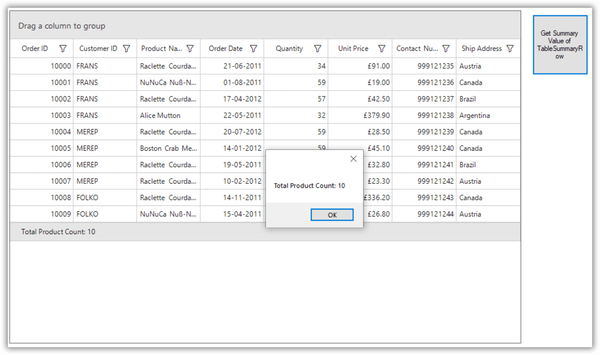
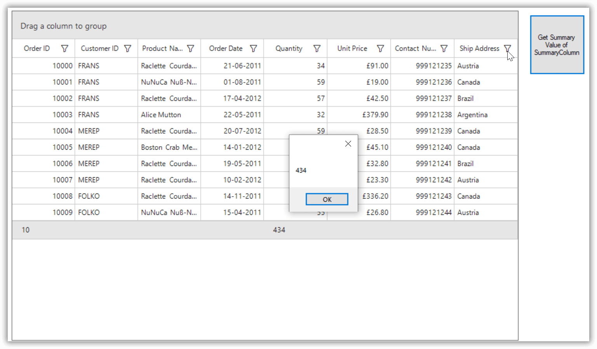

# How to Get the Summary Row Value from WinForms DataGrid?

This example illustrates how to get the summary row value from [WinForms DataGrid](https://www.syncfusion.com/winforms-ui-controls/datagrid) (SfDataGrid).

SfDataGrid allows you, to retrieve the value of summary rows by using the `SummaryCreator.GetSummaryDisplayTextForRow` method when [GridSummaryRow.ShowSummaryInRow](https://help.syncfusion.com/cr/windowsforms/Syncfusion.WinForms.DataGrid.GridSummaryRow.html#Syncfusion_WinForms_DataGrid_GridSummaryRow_ShowSummaryInRow) is true.

``` csharp
 var summary = this.sfDataGrid.View.Records.TableSummaries[0];
 var value = SummaryCreator.GetSummaryDisplayTextForRow(summary, this.sfDataGrid.View);
 MessageBox.Show(value);
```



And you can also retrieve the value of each summary column by using the SummaryCreator.GetSummaryDisplayText method when [GridSummaryRow.ShowSummaryInRow](https://help.syncfusion.com/cr/windowsforms/Syncfusion.WinForms.DataGrid.GridSummaryRow.html#Syncfusion_WinForms_DataGrid_GridSummaryRow_ShowSummaryInRow) is false.

```c#
 var summary = this.sfDataGrid.View.Records.TableSummaries[0];
 //Retrieves the summary row value of the Quantity column. 
 var value = SummaryCreator.GetSummaryDisplayText(summary, "Quantity", this.sfDataGrid.View);
 MessageBox.Show(value);
```


